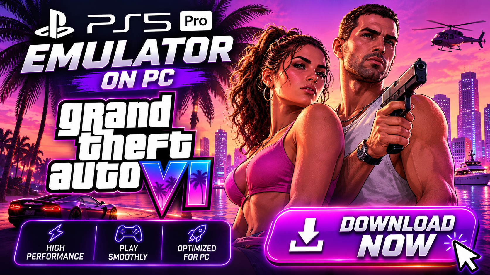
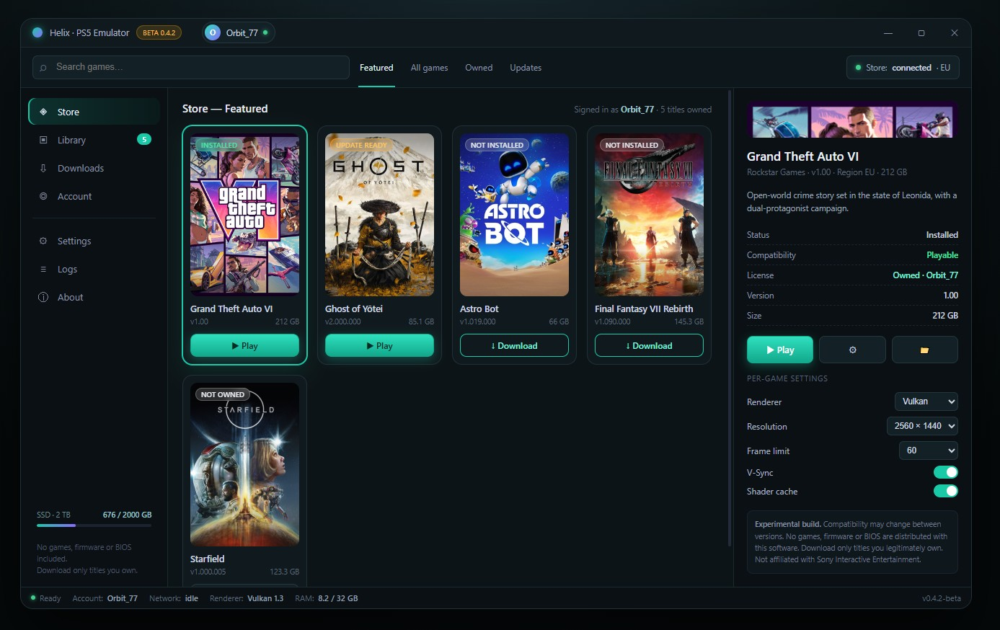
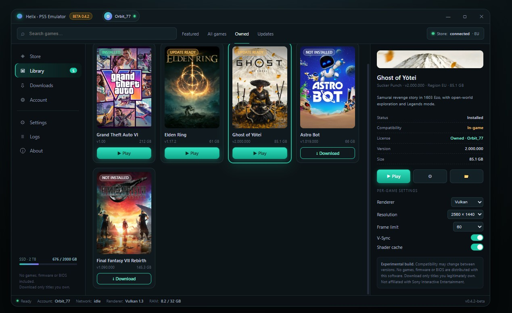
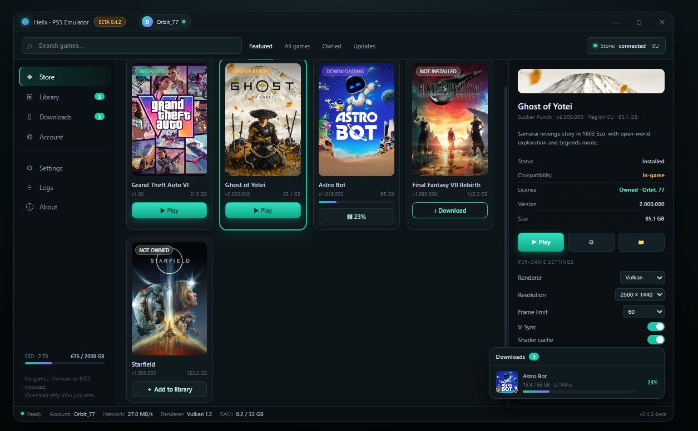
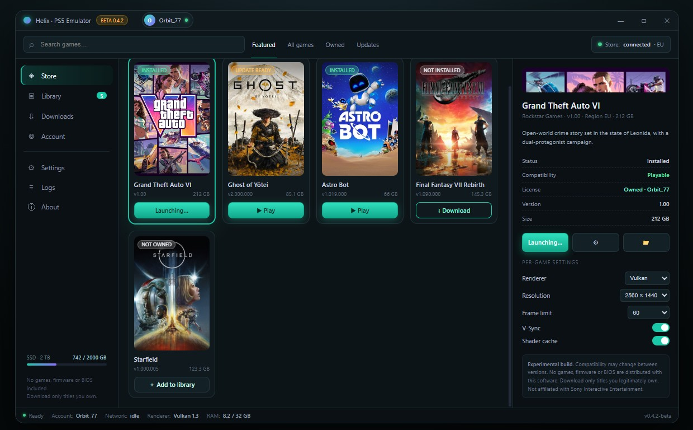

# 🎮 PS5 Pro Emulator

**An independent PlayStation 5 Pro emulation project for Windows.**
*Bringing console emulation technology to PC.*

 

 

[📖 About](#-about) •
[✨ Features](#-features) •
[📸 Screenshots](#-screenshots) •
[💻 Requirements](#-system-requirements) •
[📦 Installation](#-installation) •
[🛠️ Development](#️-development) •
[🗺️ Roadmap](#️-roadmap)

---

## 📖 About

**PS5 Pro Emulator** is an independent software project that aims to bring PlayStation 5 Pro emulation capabilities to Windows-based PCs.

The project focuses on building a convenient and accessible emulation environment, with an emphasis on:

- 🧩 **Usability** — a simple and clear interface
- ⚡ **Performance** — efficient use of system resources
- 🔧 **Compatibility** — steadily growing software support
- 🔄 **Continuous improvement** — regular refinements and updates

**Version 14.23** is the current release. Development is focused on refining the software, improving the overall user experience, and expanding its capabilities.

This repository is the main place for project information, updates, documentation, and development-related resources.

---

## ✨ Features

| | Feature | Description |
|:-:|---|---|
| 🎮 | **Game Management** | Manage supported game files through the emulator |
| 🖥️ | **Windows Support** | Designed for Windows-based PC systems |
| ⚙️ | **Configuration** | Customize available emulator settings |
| 🚀 | **Performance** | Development focused on performance improvements |
| 🔧 | **Compatibility** | Ongoing work on supported software compatibility |
| 🎨 | **User Interface** | Simple and accessible application interface |
| 🔄 | **Updates** | Continued development and future improvements |

---

## 📸 Screenshots

> [!NOTE]
> Screenshots will be added here. Place your images in a `screenshots/` folder.

| Main Interface |
|:-:|
|  | 
|  | 
|  | 
|  | 

---

## 💻 System Requirements

Recommended specifications (for reference):

| Component | Recommended |
|---|---|
| 🪟 **Operating System** | Windows 10 / 11 (64-bit) |
| 🧠 **Processor** | Modern multi-core CPU |
| 💾 **RAM** | 16 GB or more |
| 🎨 **Graphics** | Dedicated GPU |
| 📀 **Storage** | Depends on application and game files |

> [!NOTE]
> Actual requirements and performance depend on the emulator implementation and supported features.

---

## 📦 Installation

1. Open the [**Releases**](../../releases) section of this repository.
2. Download the latest available release.
3. Extract the downloaded archive, if applicable.
4. Run the emulator executable.
5. Configure the available settings.
6. Load supported game files.

> [!TIP]
> Make sure to use the correct release and follow any installation instructions included with the downloaded files.

---

## ⚙️ Project Information

| Property | Value |
|---|---|
| **Project** | PS5 Pro Emulator |
| **Version** | 14.23 |
| **Platform** | Windows |
| **Architecture** | 64-bit |
| **Category** | Game Emulation |
| **Developer** | Independent Developer |
| **Repository** | GitHub |

---

## 🛠️ Development

The project is independently developed and maintained.

**Development priorities:**

- [x] Independent development and maintenance
- [ ] Improving overall software stability
- [ ] Refining the user interface
- [ ] Working on game compatibility
- [ ] Optimizing resource usage
- [ ] Improving configuration options
- [ ] Fixing reported bugs
- [ ] Introducing new functionality where possible

Contributions, useful feedback, and well-documented bug reports are appreciated. 🤝

---

## 🐛 Bug Reports & Feedback

Found an issue? Please open one in the [**Issues**](../../issues) section and include as much information as possible:

<b>📋 What to include in a bug report</b>

 

- Emulator version
- Windows version
- CPU and GPU specifications
- Steps to reproduce the issue
- Error messages or screenshots

---

## 🗺️ Roadmap

Future development may focus on:

- 🔧 Additional compatibility improvements
- 🎨 Interface refinements
- ⚡ Performance optimizations
- ⚙️ Expanded configuration options
- 🪲 Improved error reporting
- 📚 Additional documentation

> [!NOTE]
> The roadmap may change as development progresses.

---

## ⚖️ Disclaimer

> [!IMPORTANT]
> **PS5 Pro Emulator** is an independent, unofficial software project.
> It is **not affiliated with, endorsed by, or sponsored by** Sony Interactive Entertainment.
>
> *PlayStation* and *PS5* are trademarks of Sony Interactive Entertainment.

Users are responsible for ensuring that they have the necessary rights to use any firmware, game files, or other copyrighted materials.

---

## ❤️ Support the Project

If you're interested in the development of this project, consider giving it a ⭐ and following the repository to stay informed about future updates.

Feedback and constructive suggestions are always welcome.

 

**Thank you for your interest and support!**

 

**PS5 Pro Emulator v14.23**
*Independent development. Continuous improvement.*

Keywords:
gta 6 release, gta 6 release date, gta 6 ps5, ps5 gta 6, ps5, xbox, xbox gta 6, gta 6 pc, gta 6 xbox, gta 6 price, rockstar, gta 6 online, what is gta 6, gta 6 pre order, pre order gta 6, lucia gta 6, gta 6 lucia, when gta 6 come out, is gta 6 out, gta6, playstation, gta 6 map, gta 6 playstation, playstation 6, gta 6 trailer, trailer gta 6, when does gta 6 come out, gta vi, gta 6 ultimate edition, gta 6 cost, rockstar games, rockstar games gta 6, how much is gta 6, gta 6 reddit, reddit gta 6, gta 6 xbox series s, xbox series s, jason gta 6, gta 6 pc release, when is gta 6 coming out, gta 6 news, gta 6 release date 2026, xbox series x, gta 6 ps5 pro, gta 6 ps4, gta 6 xbox series x, ps5 pro, gta 6 review, gta 6 leaks, gta 6 netflix
 